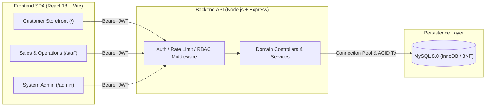

# Lumière Cosmetics — E-Commerce & Retail Operations Platform


**Lumière Cosmetics** là nền tảng thương mại điện tử và quản trị vận hành bán lẻ mỹ phẩm full-stack, được thiết kế theo kiến trúc đa phân hệ (**Storefront**, **Sales & Operations**, **System Administration**) trên nền RESTful API và cơ sở dữ liệu quan hệ MySQL 8.0 tuân thủ chuẩn ACID.

---

## Điểm nhấn Kỹ thuật (Engineering Highlights)

- **Giao dịch Tồn kho & Hóa đơn chuẩn ACID:** Sử dụng cơ chế khóa dòng bi quan (`SELECT ... FOR UPDATE`) trong MySQL Transaction để chống bán vượt tồn kho (overselling) khi xử lý đồng thời. Quy trình duyệt đơn tự động trừ kho nguyên tử, phát hành hóa đơn bán lẻ (`HD-YYYYMMDD-XXXX`), và hoàn trả tồn kho chính xác khi hủy đơn.
- **Cô lập Phiên Đa Phân hệ (Multi-Portal Session Isolation):** Tách biệt hoàn toàn ngữ cảnh xác thực và Axios Interceptor cho 3 cổng (`Customer`, `Sales Staff`, `Admin`), cho phép vận hành đồng thời nhiều vai trò trên cùng trình duyệt mà không xung đột JWT.
- **Kiểm soát Truy cập RBAC Đa tầng & Toàn vẹn Tham chiếu:** Xác thực trạng thái tài khoản theo thời gian thực tại tầng middleware, giới hạn tần suất đăng nhập (Rate Limiting), khóa đăng nhập chéo cổng, chặn tự hạ quyền/khóa tài khoản quản trị đang hoạt động, và cơ chế xóa lai (hard-delete hoặc tự động soft-lock khi phát sinh dữ liệu giao dịch lịch sử).
- **Kiểm thử Tích hợp Tự động (Integration Test Suite):** Tích hợp bộ kịch bản kiểm thử tự động kiểm chứng 26 luồng nghiệp vụ, phân quyền và rollback giao dịch trực tiếp trên MySQL.

---

## Kiến trúc Hệ thống (System Architecture)



---

## Công nghệ Sử dụng (Tech Stack)

| Phân tầng | Công nghệ & Thư viện | Vai trò chính |
| :--- | :--- | :--- |
| **Frontend** | React 18, Vite 5, React Router v6 | Kiến trúc SPA đa phân hệ, định tuyến bảo vệ theo vai trò (`ProtectedRoute`) |
| **UI & Biểu đồ** | Tailwind CSS 3, Lucide Icons, Recharts | Giao diện responsive, trực quan hóa báo cáo doanh thu & vận hành |
| **HTTP Client** | Axios | Quản lý request/response interceptors tách biệt cho từng phân hệ |
| **Backend** | Node.js, Express 4 | Xây dựng RESTful API, xử lý lỗi tập trung, middleware bảo mật & rate limit |
| **Bảo mật** | JSON Web Token (`jsonwebtoken`), `bcryptjs` | Xác thực stateless, mã hóa mật khẩu một chiều, phân quyền RBAC |
| **Cơ sở dữ liệu** | MySQL 8.0 (`mysql2/promise`) | Lưu trữ chuẩn hóa 3NF (8 bảng InnoDB, `utf8mb4`), Connection Pool & Transaction |
| **Hạ tầng** | Docker, Docker Compose, Adminer | Đóng gói môi trường cơ sở dữ liệu và công cụ quản trị DB trực quan |

---

## Các Phân hệ Chức năng (Platform Modules)

### 1. Customer Storefront (`/`)
- Tra cứu danh mục mỹ phẩm đa tiêu chí: từ khóa, danh mục, thương hiệu, loại da, khoảng giá và sắp xếp linh hoạt.
- Kiểm tra tồn kho theo thời gian thực; tự động vô hiệu hóa đặt mua với sản phẩm hết hàng hoặc tạm ẩn.
- Quản lý giỏ hàng bền vững, đặt hàng trực tuyến, theo dõi tiến độ xử lý đơn và cập nhật hồ sơ cá nhân.

### 2. Sales & Operations Portal (`/staff`)
- **Dashboard Doanh thu:** Thống kê doanh thu thực tế (chỉ ghi nhận từ đơn đã duyệt), biểu đồ xu hướng và tỷ trọng trạng thái đơn hàng.
- **Quản trị Danh mục & Kho:** Thêm mới, cập nhật thông tin, điều chỉnh tồn kho và kiểm soát trạng thái hiển thị sản phẩm.
- **Xử lý Đơn hàng:** Duyệt đơn (trừ kho tự động + sinh hóa đơn) hoặc hủy đơn (kèm lý do kiểm toán và hoàn kho tự động nếu đơn đã duyệt).
- **Quản lý Hóa đơn:** Tra cứu hóa đơn theo khoảng thời gian và kết xuất biểu mẫu hóa đơn chuẩn in A4 / PDF.

### 3. System Administration Portal (`/admin`)
- Quản lý vòng đời tài khoản người dùng (khách hàng, nhân viên bán hàng, quản trị viên).
- Phân quyền RBAC, khóa/mở khóa tài khoản tức thời (hiệu lực ngay ở request kế tiếp).
- Giám sát trạng thái kết nối dịch vụ API và cơ sở dữ liệu (`/admin/system`).

---

## Cấu trúc Dự án (Project Structure)

```text
WebMyPham/
├── backend/
│   ├── scripts/
│   │   ├── initDb.js              # Khởi tạo / đồng bộ lại schema & seed data
│   │   └── verifyBackend.js       # Bộ kiểm thử tích hợp tự động 26 kịch bản API
│   ├── src/
│   │   ├── config/                # Cấu hình biến môi trường & MySQL Connection Pool
│   │   ├── controllers/           # Xử lý nghiệp vụ theo miền (Auth, Catalog, Order, Staff, Admin)
│   │   ├── middlewares/           # JWT Auth, RBAC, Rate Limiter & Error Handler tập trung
│   │   ├── routes/                # Định tuyến RESTful API (/api/*)
│   │   ├── utils/                 # AppError, Validators, AsyncWrapper, chuẩn hóa JSON response
│   │   ├── app.js                 # Khởi tạo Express pipeline
│   │   └── server.js              # Entry point máy chủ HTTP
│   ├── .env.example               # Mẫu cấu hình biến môi trường
│   └── package.json
├── frontend/
│   ├── src/
│   │   ├── api/                   # Axios instances cô lập token theo từng cổng
│   │   ├── components/            # UI components dùng chung & chuyên biệt theo phân hệ
│   │   ├── contexts/              # Quản lý trạng thái Auth, Giỏ hàng & Thông báo (Toast)
│   │   ├── pages/                 # Các trang thuộc 3 cổng: customer/, staff/, admin/
│   │   └── utils/                 # Định dạng tiền tệ, ngày giờ và custom hooks
│   ├── vite.config.js
│   └── package.json
├── database/
│   └── database.sql               # Schema chuẩn hóa 3NF (8 bảng) & dữ liệu khởi tạo
└── docker-compose.yml             # Khởi chạy MySQL 8.0 & Adminer
```

---

## Cài đặt & Khởi chạy (Getting Started)

### Yêu cầu hệ thống
- **Node.js** `>= 18.x` và **npm**
- **Docker Desktop** (khuyến nghị) hoặc **MySQL 8.0+ / MariaDB 10.4+** cài đặt trực tiếp

### Bước 1: Sao chép mã nguồn

```bash
git clone https://github.com/Pe1nt0n/WebMyPham.git
cd WebMyPham
```

### Bước 2: Khởi tạo Cơ sở dữ liệu

**Cách A — Sử dụng Docker Compose (Khuyến nghị):**

```bash
docker compose up -d
```
Lệnh trên tự động khởi chạy container `mysql:8.0` (cổng `3306`), nạp toàn bộ schema từ `database/database.sql` và mở giao diện quản trị **Adminer** tại `http://localhost:8080`.

**Cách B — Sử dụng MySQL có sẵn trên máy:**
1. Đảm bảo dịch vụ MySQL đang chạy tại cổng `3306`.
2. Cấu hình thông tin kết nối trong `backend/.env`, sau đó chạy lệnh khởi tạo tự động ở Bước 3 (`npm run db:init`).

### Bước 3: Cấu hình & Khởi chạy Backend API

```bash
cd backend
cp .env.example .env
npm install

# (Tùy chọn) Khởi tạo hoặc đặt lại cơ sở dữ liệu khi không dùng Docker entrypoint
npm run db:init

# Chạy máy chủ ở chế độ development (port 5000)
npm run dev
```
- API Base URL: `http://localhost:5000/api`
- Healthcheck: `http://localhost:5000/api/health`

### Bước 4: Khởi chạy Frontend Client

Mở một cửa sổ terminal mới:

```bash
cd frontend
npm install
npm run dev
```
- Customer Storefront: `http://localhost:5173/`
- Sales & Operations Portal: `http://localhost:5173/staff`
- System Admin Portal: `http://localhost:5173/admin`

---

## Biến Môi trường (Environment Variables)

Tệp cấu hình đặt tại `backend/.env` (tham khảo mẫu `backend/.env.example`):

| Biến | Giá trị mặc định (Dev) | Mô tả |
| :--- | :--- | :--- |
| `NODE_ENV` | `development` | Môi trường thực thi (`development` / `production`) |
| `PORT` | `5000` | Cổng lắng nghe của máy chủ Backend |
| `DB_HOST` | `127.0.0.1` | Địa chỉ máy chủ MySQL |
| `DB_PORT` | `3306` | Cổng kết nối MySQL |
| `DB_USER` | `root` | Tài khoản kết nối cơ sở dữ liệu |
| `DB_PASSWORD` | `123456` | Mật khẩu cơ sở dữ liệu *(bắt buộc thay đổi trên Production)* |
| `DB_NAME` | `cosmetic_store` | Tên cơ sở dữ liệu |
| `JWT_SECRET` | `change_me_in_prod` | Khóa bí mật ký xác thực JWT *(bắt buộc dùng chuỗi ngẫu nhiên mạnh trên Production)* |
| `JWT_EXPIRES_IN` | `7d` | Thời hạn hiệu lực của Access Token |
| `CORS_ORIGIN` | `http://localhost:5173` | Danh sách origin được phép gọi API (phân tách bằng dấu phẩy) |
| `AUTH_RATE_LIMIT_MAX` | `30` | Số request tối đa cho các endpoint xác thực trong một chu kỳ |
| `AUTH_RATE_LIMIT_WINDOW_MS` | `900000` | Chu kỳ giới hạn tần suất request (mặc định 15 phút) |

---

## Tóm tắt API Chính (API Overview)

| Nhóm | Phương thức & Đường dẫn | Quyền truy cập | Chức năng |
| :--- | :--- | :--- | :--- |
| **System** | `GET /api/health` | Public | Kiểm tra trạng thái máy chủ API và kết nối MySQL |
| **Auth** | `POST /api/auth/register`, `POST /api/auth/login` | Public (Rate-limited) | Đăng ký khách hàng và đăng nhập theo phân hệ |
| **Profile** | `GET /api/auth/me`, `PUT /api/auth/profile`, `PUT /api/auth/change-password` | Authenticated | Truy vấn thông tin phiên, cập nhật hồ sơ & đổi mật khẩu |
| **Catalog** | `GET /api/categories`, `GET /api/brands`, `GET /api/products`, `GET /api/products/:id` | Public | Tra cứu danh mục, thương hiệu, lọc & phân trang sản phẩm |
| **Orders** | `POST /api/orders`, `GET /api/orders/my-orders`, `GET /api/orders/my-orders/:id` | `CUSTOMER` | Tạo đơn đặt hàng mới và tra cứu lịch sử mua hàng cá nhân |
| **Staff** | `CRUD /api/staff/products`, `PATCH /api/staff/orders/:id/{approve,cancel}`, `GET /api/staff/invoices`, `GET /api/staff/reports/summary` | `SALES_STAFF` | Quản lý sản phẩm/kho, duyệt/hủy đơn (ACID), xuất hóa đơn & báo cáo doanh thu |
| **Admin** | `GET /api/admin/roles`, `CRUD /api/admin/users`, `PATCH /api/admin/users/:id/{role,status}` | `ADMIN` | Quản trị tài khoản, phân quyền RBAC và khóa/mở khóa người dùng |

---

## Kiểm thử & Lệnh Tiện ích (Testing & Scripts)

| Thư mục | Lệnh | Mô tả |
| :--- | :--- | :--- |
| `backend/` | `npm run dev` | Khởi chạy API server với chế độ tự động tải lại (`node --watch`) |
| `backend/` | `npm start` | Khởi chạy API server ở chế độ chuẩn |
| `backend/` | `npm run db:init` | Tái khởi tạo schema và nạp lại bộ dữ liệu chuẩn từ `database/database.sql` |
| `backend/` | `npm run test:api` | Thực thi bộ kiểm thử tích hợp tự động 26 kịch bản nghiệp vụ & giao dịch kho |
| `frontend/` | `npm run dev` | Khởi chạy Vite dev server tại cổng `5173` |
| `frontend/` | `npm run build` | Đóng gói bản build tối ưu cho môi trường Production (`dist/`) |

<details>
<summary><strong>Tài khoản Môi trường Phát triển (Seeded Sandbox Accounts)</strong></summary>

Dữ liệu khởi tạo trong `database/database.sql` cung cấp sẵn các tài khoản mẫu phục vụ kiểm thử cục bộ (mật khẩu mặc định: `123456`):

| Tài khoản (`username`) | Vai trò (`role`) | Trạng thái | Phân hệ truy cập |
| :--- | :--- | :--- | :--- |
| `admin` | `ADMIN` | `ACTIVE` | `/admin` |
| `nhanvien` | `SALES_STAFF` | `ACTIVE` | `/staff` |
| `nhanvien2` | `SALES_STAFF` | `ACTIVE` | `/staff` |
| `khachhang` | `CUSTOMER` | `ACTIVE` | `/` |
| `minhanh` | `CUSTOMER` | `ACTIVE` | `/` |
| `khachbikhoa` | `CUSTOMER` | `LOCKED` | `/` *(dùng kiểm thử chặn tài khoản bị khóa)* |

</details>

---

## License

Dự án được phân phối phục vụ mục đích phát triển và nghiên cứu kỹ thuật phần mềm. Vui lòng cập nhật khóa bảo mật (`JWT_SECRET`, thông tin xác thực cơ sở dữ liệu) trước khi triển khai lên môi trường Production.
